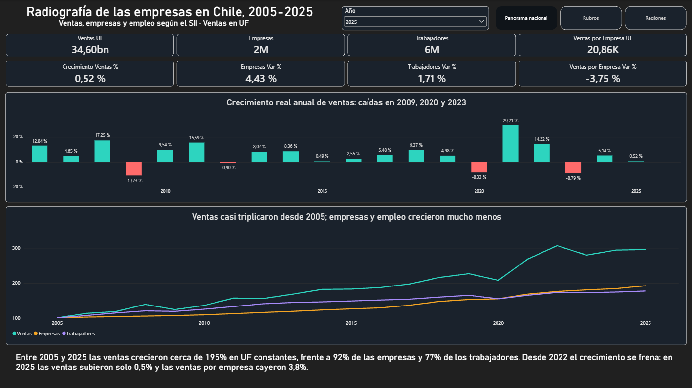
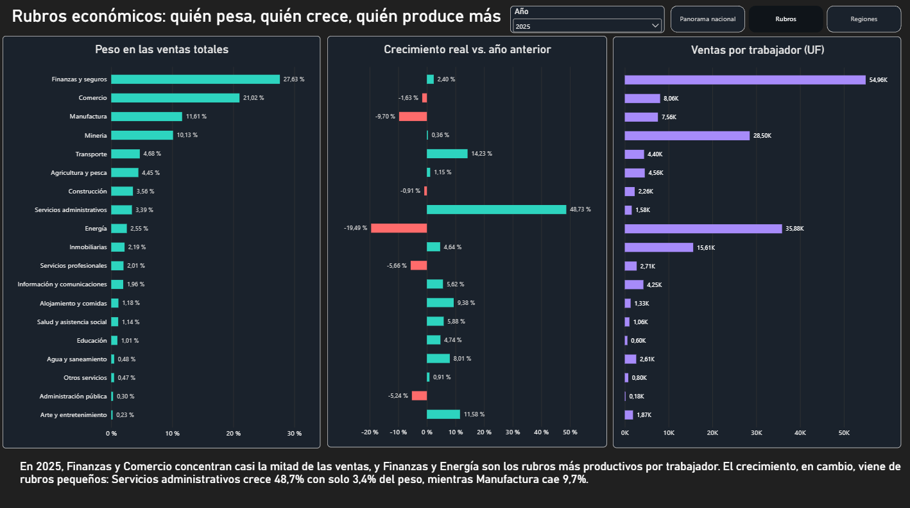
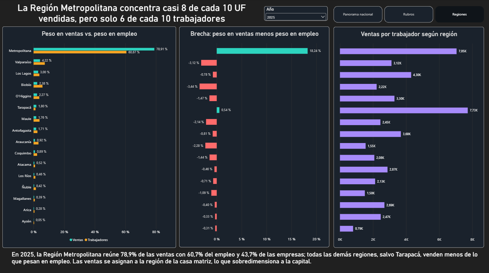
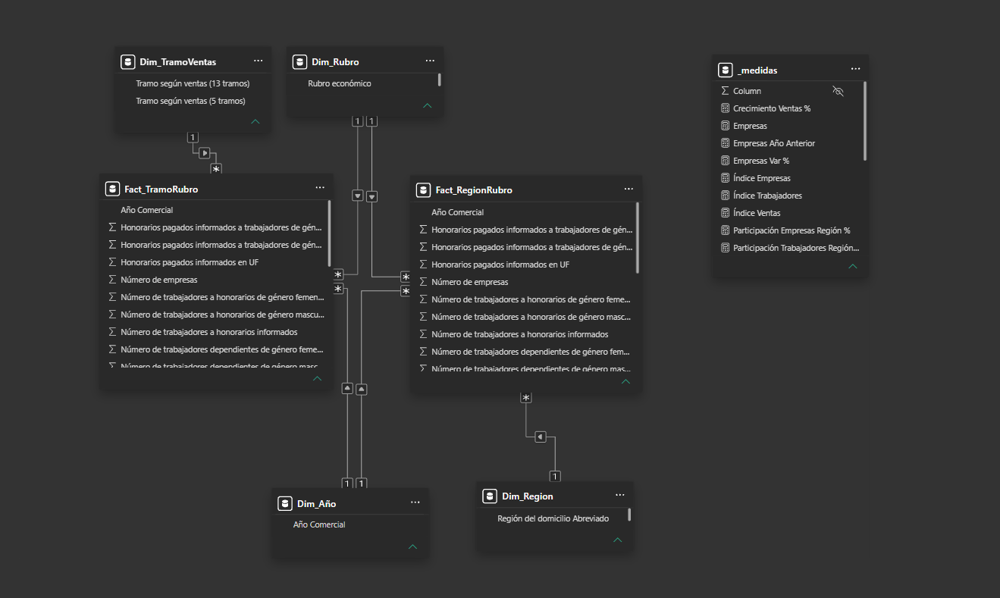

# Radiografía de empresas Chilenas, 2005-2025

Dashboard construido en Power BI con estadísticas públicas del Servicio de Impuestos Internos (SII). Analiza 20 años de ventas, empresas y trabajadores por rubro económico y región, y respondiendo tres preguntas:

1. ¿Cómo ha evolucionado la economía empresarial chilena entre 2005 y 2025?
2. ¿Qué rubros pesan más, cuáles crecen y cuáles son más productivos?
3. ¿Cómo se distribuye la actividad en el territorio?

>

## Páginas del dashboard

| Página | Pregunta que responde |
|---|---|
| **Panorama nacional** | Evolución de ventas, empresas y trabajadores 2005-2025 (índice base 2005 = 100) y crecimiento real anual |
| **Rubros económicos** | Peso en las ventas, crecimiento real y productividad de cada rubro |
| **Regiones** | Peso de cada región en ventas vs. empleo, brecha entre ambos y productividad regional |

## Fuente de datos

- **Servicio de Impuestos Internos (SII)**, estadísticas de empresas, descargadas desde el sitio oficial.
- Archivos utilizados: `PUB_REGRUBG.txt` (región y rubro) y `PUB_TRAMRUBR.txt` (tramo de ventas y rubro).
- Período: años comerciales 2005 a 2025.
- Las ventas están expresadas en **UF**, por lo que las variaciones son en **términos reales**.

## Proceso

1. **Extracción:** descarga de los archivos desde el sitio oficial del SII.
2. **Carga y transformación en Power Query:**
   - Importación de los archivos de texto.
   - Creación de las tablas de dimensiones (`Dim_Año`, `Dim_Region`, `Dim_Rubro`, `Dim_TramoVentas`).
   - Edición de variables y creación de versiones **abreviadas** de los nombres de rubro económico y de región, para mejorar la lectura en los gráficos.
3. **Modelado:** esquema en estrella con dos tablas de hechos (`Fact_RegionRubro`, `Fact_TramoRubro`) conectadas a las dimensiones.
4. **Medidas DAX:** ventas, empresas, trabajadores, crecimiento interanual, participaciones, productividad, índices base 2005 y brecha ventas vs. empleo por región.
5. **Visualización:** tres páginas con títulos que enuncian el hallazgo, paleta oscura consistente y filtro de año sincronizada.

## Modelo de datos

- **Dimensiones:** `Dim_Año`, `Dim_Region`, `Dim_Rubro`, `Dim_TramoVentas`.
- **Hechos:** `Fact_RegionRubro` (ventas, empresas, trabajadores, renta, honorarios por región y rubro) y `Fact_TramoRubro` (los mismos indicadores por tramo de ventas y rubro).
- **Medidas** agrupadas en tabla dedicada (`_medidas`).

## Validaciones realizadas

- La serie cubre los 21 años (2005-2025) sin huecos.
- Las participaciones por rubro y por región suman 100% en el total.
- El total de ventas de 2025 coincide entre las distintas páginas.
- La categoría "Sin información" pesa menos de 0,01% de las ventas y se excluye de los gráficos de rubros y regiones.
- Las medidas de variación y productividad solo se calculan con un único año en contexto.

## Hallazgos clave

1. **Las ventas casi triplicaron entre 2005 y 2025** (índice ~295 con base 2005 = 100), mientras las empresas crecieron ~92% y los trabajadores ~77%.
2. **Tres contracciones en 20 años:** 2009 (-10,7%), 2020 (-8,3%) y 2023 (-8,8%). 
3. **Desaceleración reciente:** en 2025 las ventas crecieron 0,5% y las ventas por empresa cayeron 3,8%, porque el número de empresas siguió creciendo (+4,4%).
4. **Concentración sectorial (2025):** Finanzas (27,6%) y Comercio (21,0%) suman casi la mitad de las ventas.
5. **Los rubros grandes no son los que más crecen:** Servicios administrativos creció 48,7% con solo 3,4% del peso, mientras Manufactura cayó 9,7%.
6. **Productividad:** Finanzas (~55 mil UF por trabajador) y Energía (~36 mil) lideran, muy por encima de rubros como Alojamiento, Salud u Otros servicios (menos de 1,5 mil).
7. **Concentración territorial (2025):** la Región Metropolitana reúne 78,9% de las ventas con 60,7% de los trabajadores y 43,7% de las empresas; salvo Tarapacá, las demás regiones venden menos de lo que pesan en empleo.

## Limitaciones

- Las ventas se asignan a la **región del domicilio o casa matriz**, no al lugar donde se produce. Sobredimensionando a la Región Metropolitana.
- Los cambios de clasificación entre años podrían afectar la comparabilidad de algunos rubros. Las variaciones extremas (por ejemplo Servicios administrativos y Energía en 2025) conviene contrastarlas con su serie histórica antes de interpretarlas.
- El análisis es descriptivo: muestra qué ocurrió, no establece causas.

## Herramientas

Power BI Desktop, Power Query y DAX.

